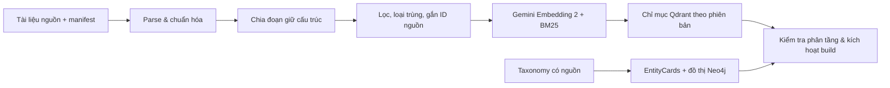
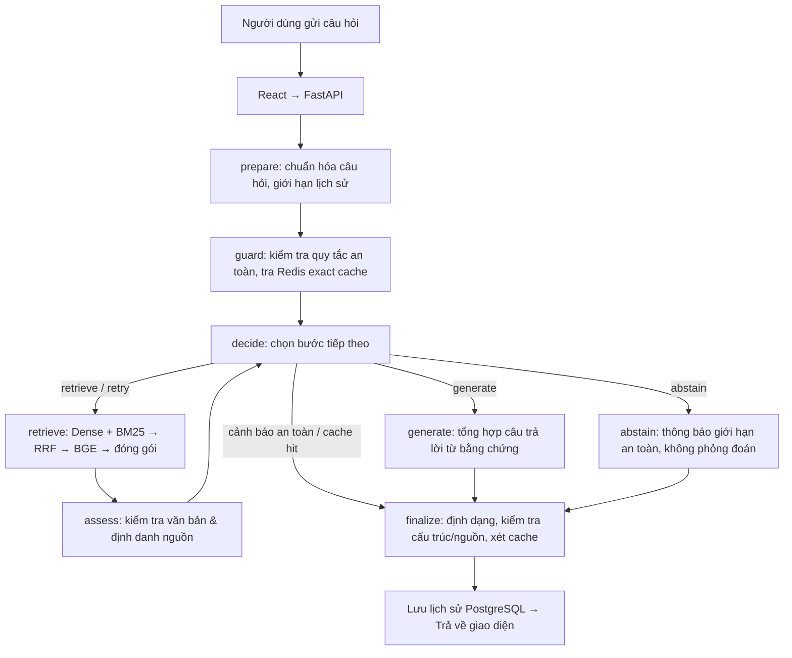

<!-- markdownlint-configure-file
{"MD013":{"tables":false,"code_blocks":false}}
-->

# Acne Advisor AI

**Trợ lý tra cứu thông tin về mụn trứng cá và chăm sóc da liên quan bằng tiếng Việt, vận hành theo kiến trúc Agentic RAG có kiểm chứng nguồn bằng chứng.**

Hệ thống tiếp nhận câu hỏi tiếng Việt qua giao diện web, thực hiện truy xuất đa kênh (ngữ nghĩa + từ khóa) trên kho tài liệu y khoa chuẩn hóa, tự đánh giá mức độ đầy đủ bằng chứng trước khi tổng hợp câu trả lời kèm trích dẫn nguồn rõ ràng. Nếu bằng chứng chưa đủ hoặc câu hỏi thuộc tình huống cần thăm khám/cấp cứu, hệ thống có thể tìm bổ sung tối đa một lần hoặc chủ động từ chối an toàn (*safe abstention*) thay vì suy đoán.

> [!NOTE]
> **Phạm vi sử dụng:** Đây là hệ thống hỗ trợ tra cứu thông tin và nghiên cứu phát triển cục bộ, **chưa được kiểm định lâm sàng**; hệ thống **không** chẩn đoán bệnh lý, **không** kê đơn/tính liều thuốc cá nhân hóa và **không** phân tích ảnh da.

---

## Mục lục

- [1. Tính năng chính](#1-tính-năng-chính)
- [2. Kết quả đánh giá định lượng (RAGAS 50 ca)](#2-kết-quả-đánh-giá-định-lượng-ragas-50-ca)
- [3. Kiến trúc hệ thống & luồng xử lý](#3-kiến-trúc-hệ-thống--luồng-xử-lý)
- [4. Kho tri thức & dữ liệu](#4-kho-tri-thức--dữ-liệu)
- [5. Hướng dẫn cài đặt & sử dụng cho người mới](#5-hướng-dẫn-cài-đặt--sử-dụng-cho-người-mới)
  - [5.1. Yêu cầu tiên quyết](#51-yêu-cầu-tiên-quyết)
  - [5.2. Cách 1 — Chạy nhanh trọn bộ bằng Docker Compose (Khuyên dùng)](#52-cách-1--chạy-nhanh-trọn-bộ-bằng-docker-compose-khuyên-dùng)
  - [5.3. Cách 2 — Cài đặt môi trường phát triển cục bộ trên host](#53-cách-2--cài-đặt-môi-trường-phát-triển-cục-bộ-trên-host)
- [6. Cấu hình biến môi trường (`.env`)](#6-cấu-hình-biến-môi-trường-env)
- [7. Tham chiếu HTTP API](#7-tham-chiếu-http-api)
- [8. Kiểm thử phần mềm & chạy đánh giá RAGAS](#8-kiểm-thử-phần-mềm--chạy-đánh-giá-ragas)
- [9. Cấu trúc mã nguồn](#9-cấu-trúc-mã-nguồn)
- [10. Xử lý sự cố thường gặp](#10-xử-lý-sự-cố-thường-gặp)
- [11. Giới hạn & tài liệu chuyên sâu](#11-giới-hạn--tài-liệu-chuyên-sâu)

---

## 1. Tính năng chính

- **Tra cứu y khoa bám sát bằng chứng:** Trả lời các câu hỏi về phân loại tổn thương mụn, cơ chế bệnh sinh, so sánh hoạt chất, nguyên tắc điều trị, an toàn thuốc (mang thai, xét nghiệm theo dõi, tương tác) và chăm sóc da kèm nguồn trích dẫn minh bạch.
- **Hỏi tiếp nối theo ngữ cảnh hội thoại:** Tận dụng lịch sử hội thoại có kiểm soát độ dài để hiểu đúng câu hỏi nối tiếp của người dùng.
- **Kiểm soát Agentic RAG hữu hạn:** Cho phép mô hình chọn hành động (`retrieve`, `retry`, `generate`, `abstain`) ở định dạng JSON có ràng buộc; tầng Python xác thực chặt chẽ số vòng lặp, ngân sách thời gian, danh sách nguồn hợp lệ (`source_allowlist`) và điều kiện lưu cache.
- **Từ chối an toàn & phát hiện tình huống khẩn cấp:** Tự động chặn và khuyến cáo đi cấp cứu/thăm khám bác sĩ với các triệu chứng nguy hiểm hoặc yêu cầu kê đơn/tính liều thuốc cá nhân hóa, đồng thời từ chối lịch sự các câu hỏi ngoài miền da liễu.
- **Linh hoạt nhà cung cấp LLM:** Hỗ trợ Gemini (mặc định `gemini-3.5-flash-lite`) và Ollama cục bộ (như `qwen3:8b`), kèm tùy chọn fallback an toàn khi cấu hình cho phép.
- **Quản lý phiên trò chuyện đầy đủ:** Tạo mới, đổi tên, ẩn và đồng bộ lịch sử trò chuyện trong PostgreSQL; tối ưu tốc độ phản hồi bằng Redis exact cache.

---

## 2. Kết quả đánh giá định lượng (RAGAS 50 ca)

Hệ thống được đánh giá định lượng trên bộ benchmark **50 câu hỏi tiếng Việt** ([`evaluation/dataset.json`](evaluation/dataset.json): 42 câu có bằng chứng thuộc 6 nhóm chủ đề + 8 câu kiểm thử từ chối an toàn) theo khung **RAGAS** (*Retrieval Augmented Generation Assessment*, Es et al., 2023, `arXiv:2309.15217`).

Để tránh thiên vị tự chấm, quá trình đánh giá tách biệt hoàn toàn giữa **System LLM** (`gemini-3.5-flash-lite`) và **Judge LLM độc lập** qua NVIDIA NIM (`nvidia/nemotron-3-ultra-550b-a55b` 550B / 55B active, dự phòng `mistralai/mistral-large-4-1t-a52b`), sử dụng embedding `models/gemini-embedding-2` (3.072 chiều) trên Knowledge Build **`b768fae999391f47760a`**:

| Chỉ số | Trung bình | Thấp nhất | Cao nhất | Số ca chấm | Đánh giá |
| --- | :---: | :---: | :---: | :---: | --- |
| **Faithfulness** (*Độ trung thực với bằng chứng*) | **0.910** | 0.200 | 1.000 | 41/42 | Tốt (>= 0.80) |
| **Answer Relevancy** (*Độ liên quan câu trả lời*) | **0.931** | 0.825 | 1.000 | 42/42 | Tốt (>= 0.80) |
| **Context Precision** (*Độ chính xác ngữ cảnh*) | **0.980** | 0.500 | 1.000 | 42/42 | Tốt (>= 0.80) |
| **Context Recall** (*Độ bao phủ ngữ cảnh*) | **0.894** | 0.000 | 1.000 | 42/42 | Tốt (>= 0.80) |
| **Answer Correctness** (*Độ chính xác câu trả lời*) | **0.739** | 0.353 | 0.993 | 42/42 | Khá (0.65 - 0.79) |
| **Safe Abstention Accuracy** (*Tỷ lệ từ chối an toàn*) | **1.000** | — | — | **8/8** | Tuyệt đối (100%) |

- **Chỉ số vận hành thực tế:** **0 lỗi runtime** trên toàn bộ 50 ca; độ trễ trung bình `10,597.8 ms` (P50 `11,505.0 ms`, P95 `16,615.9 ms`); tổng token sinh câu trả lời `106,669`.
- **Chi tiết kết quả & hướng dẫn chạy lại:** xem [tài liệu đánh giá RAGAS](evaluation/README.md) và [notebook đánh giá 50 ca](evaluation/ragas_evaluation.ipynb).

---

## 3. Kiến trúc hệ thống & luồng xử lý

Hệ thống tách biệt rạch ròi giữa **quy trình chuẩn bị kho tri thức (ngoại tuyến)** và **quy trình hỏi-đáp trực tuyến**. Khi người dùng chat, API chỉ đọc chỉ mục Qdrant đã được kiểm định và kích hoạt; không tự crawl web hay thay đổi dữ liệu nền.

### Thành phần công nghệ

| Thành phần | Công nghệ sử dụng | Vai trò trong hệ thống |
| --- | --- | --- |
| **Giao diện web** | React 19, Vite, Nginx | Chat trực tuyến, quản lý phiên, chọn model, hiển thị nguồn trích dẫn |
| **Backend API** | FastAPI, Uvicorn | Kiểm tra hợp lệ đầu vào, điều phối Agent, quản lý HTTP và lịch sử |
| **Điều phối Agent** | LangGraph (8 node) | Vòng lặp truy xuất hữu hạn, thực thi chuyển trạng thái |
| **Sinh ngôn ngữ** | Google Gemini / Ollama | Chọn bước xử lý (`action_decision`) và tổng hợp câu trả lời |
| **Truy xuất kết hợp** | Qdrant + Gemini Embedding 2 + BM25 | Tìm kiếm song song theo ngữ nghĩa (Dense) và từ khóa (Sparse BM25) |
| **Xếp hạng lại (Reranker)** | `BAAI/bge-reranker-v2-m3` | Chấm điểm cặp câu hỏi–đoạn văn bằng Cross-Encoder trên GPU/CPU cục bộ |
| **Lưu trữ hội thoại** | PostgreSQL | Lưu phiên chat và nội dung tin nhắn |
| **Cache phản hồi** | Redis (v10) | Exact cache câu trả lời đủ điều kiện theo phiên bản pipeline |
| **Tri thức cấu trúc** | Neo4j, EntityCards | Kiểm tra cấu trúc thực thể/quan hệ và phục vụ nghiên cứu |

> [!IMPORTANT]
> Neo4j và EntityCards dùng cho kiểm tra cấu trúc tri thức và nghiên cứu; **bằng chứng y khoa dùng để sinh câu trả lời trực tuyến hoàn toàn đến từ các knowledge chunk trong Qdrant**.

### Luồng A — Chuẩn bị & kích hoạt kho tri thức



- Mỗi đoạn kiến thức giữ đầy đủ `source_id`, `document_id`, vị trí và mã băm SHA-256 nội dung để truy vết ngược.
- Chia đoạn bảo toàn tiêu đề, danh sách, bảng biểu với giới hạn `2.400` ký tự Unicode (không chồng lặp).
- Kích hoạt build mới luôn kiểm tra đa tầng (`status` / `validate`) và yêu cầu điểm khôi phục (*rollback point*).

### Luồng B — Xử lý câu hỏi trực tuyến (LangGraph 8 node)



### Chính sách & giới hạn mặc định

| Tham số kỹ thuật | Giá trị mặc định | Ý nghĩa vận hành |
| --- | :---: | --- |
| Số lần truy xuất tối đa | **2 lần** | 1 lần tìm chính + tối đa 1 lần tìm bổ sung (`retry`) |
| Số ứng viên mỗi kênh | **16 đoạn** | Đầu vào từ mỗi kênh Dense và BM25 trước khi hợp nhất |
| Ngữ cảnh đưa vào LLM | **Tối đa 9 đoạn / 7.000 ký tự** | Giữ nguyên vẹn đoạn văn kèm metadata nguồn; ưu tiên bằng chứng trực tiếp |
| Thuật toán hợp nhất | **RRF (`k=60`, trọng số `1:1`)** | Kết hợp thứ hạng từ Dense và BM25 độc lập với thang điểm |
| Timeout mỗi kênh truy xuất | **20 giây** | Hai kênh chạy song song độc lập; lỗi 1 kênh vẫn giữ kết quả kênh còn lại |
| Tổng ngân sách xử lý Agent | **210 giây** | Dùng chung `DeadlineBudget` xuyên suốt toàn bộ 8 node |

---

## 4. Kho tri thức & dữ liệu

Thông tin build đang kích hoạt được lưu trong [`data/knowledge_build_manifest.json`](data/knowledge_build_manifest.json) với mã định danh **`b768fae999391f47760a`**:

| Tài sản tri thức | Quy mô / cấu hình hiện hành |
| --- | --- |
| **Gói nguồn chuẩn hóa** | 1 gói nguồn tổng hợp ([`Acne_data_source.json`](sample_data/Acne_data_source.json), quy tụ **53 nguồn y khoa**) |
| **Knowledge chunks** | **968 đoạn** văn bản y khoa chuẩn hóa |
| **EntityCards** | **32 thẻ** thực thể |
| **Đồ thị Neo4j** | **32 node**, **27 quan hệ** |
| **Vector Dense** | `models/gemini-embedding-2`, **3.072 chiều**, khoảng cách `cosine` |
| **Vector Sparse** | **BM25 gốc của Qdrant** (tokenizer `word`, lowercase + ASCII folding) |
| **Alias logic** | `acne_knowledge`, `acne_entities` |

Các nguồn y khoa trong bộ dữ liệu gồm hướng dẫn lâm sàng và tài liệu giáo dục bệnh nhân từ **EuroGuiDerm, NICE NG198, AAD/JAAD, Bộ Y tế Việt Nam, các Bệnh viện Da liễu, FDA, Cochrane, BAD, DailyMed, MotherToBaby, DermNet, Cleveland Clinic, MedlinePlus và NIAMS**. Chi tiết metadata nằm tại [`data/sources/manifest.yaml`](data/sources/manifest.yaml).

> [!TIP]
> Với máy đã có sẵn kho dữ liệu `data/`, luôn kiểm tra tính toàn vẹn bằng hai lệnh sau (không chạy lại `build` một cách không cần thiết):
> ```powershell
> .\.venv\Scripts\python.exe scripts\knowledge_build.py status
> .\.venv\Scripts\python.exe scripts\knowledge_build.py validate
> ```

---

## 5. Hướng dẫn cài đặt & sử dụng cho người mới

### 5.1. Yêu cầu tiên quyết

- **Git** và **Docker Desktop** (đã bật Linux containers / WSL 2 trên Windows).
- **Python 3.11** (khuyên dùng đúng bản **`3.11.9`** theo [`.python-version`](.python-version)) và **Node.js 24** (`npm`) nếu chạy trực tiếp trên máy host hoặc phát triển code.
- **API Key bắt buộc:** `GOOGLE_API_KEY` (từ Google AI Studio để dùng `gemini-3.5-flash-lite` và `models/gemini-embedding-2`).
- **API Key tùy chọn:** `NVIDIA_API_KEY` (nếu chạy đánh giá RAGAS 50 ca bằng Judge NIM), `LLAMA_CLOUD_API_KEY` (nếu parse PDF nguồn mới).
- **Phần cứng:** RAM tối thiểu 16 GB khuyến nghị; có GPU NVIDIA hỗ trợ CUDA giúp reranker BGE chạy nhanh hơn (tự động fallback về CPU/FP32 nếu không có GPU).

---

### 5.2. Cách 1 — Chạy nhanh trọn bộ bằng Docker Compose (Khuyên dùng)

Cách này khởi chạy toàn bộ 6 container (`frontend`, `backend`, `postgres`, `redis`, `qdrant`, `neo4j`) mà không cần tự cấu hình dịch vụ rời rạc.

#### Bước 1: Clone mã nguồn và tạo file `.env`

```powershell
git clone https://github.com/MinhHoang1403/Acne_Advisor_AI.git
Set-Location Acne_Advisor_AI
if (-not (Test-Path .env)) { Copy-Item .env.example .env }
```

Mở file `.env` và điền **`GOOGLE_API_KEY`** của bạn (giữ nguyên `EMBEDDING_MODEL=models/gemini-embedding-2` và `EMBEDDING_DIMENSIONS=3072` để khớp với chỉ mục Qdrant).

#### Bước 2: Chuẩn bị cache model Reranker (`BAAI/bge-reranker-v2-m3`)

Container backend nạp model reranker từ cache cục bộ gắn read-only tại `${USERPROFILE}/.cache/huggingface/hub` (có thể đổi qua `HF_MODEL_CACHE_PATH` trong `.env`), không tự tải lúc runtime. Nếu máy chưa từng tải model này, hãy tải trước một lần bằng Python 3.11:

```powershell
py -3.11 -m pip install huggingface-hub
py -3.11 -c "from huggingface_hub import snapshot_download; snapshot_download('BAAI/bge-reranker-v2-m3')"
```

#### Bước 3: Build image và khởi động hệ thống

```powershell
docker compose config --quiet
docker compose build backend frontend

# Nếu máy chạy CPU thông thường:
docker compose up -d

# HOẶC nếu máy có GPU NVIDIA hỗ trợ Docker GPU (dùng thay lệnh trên):
docker compose -f docker-compose.yml -f docker-compose.gpu.yml up -d

# Kiểm tra trạng thái toàn bộ container:
docker compose ps
```

Khi toàn bộ 6 container chuyển sang trạng thái `Up (healthy)`, truy cập các địa chỉ sau:

| Đường dẫn | Chức năng |
| --- | --- |
| <http://127.0.0.1:8088> | **Giao diện chat Acne Advisor AI** |
| <http://127.0.0.1:8000/docs> | Tài liệu API tương tác (Swagger / OpenAPI) |
| <http://127.0.0.1:8088/api/live> | Kiểm tra tiến trình API đang chạy |
| <http://127.0.0.1:8088/api/ready> | Kiểm tra các phụ thuộc cốt lõi đã sẵn sàng |
| <http://127.0.0.1:8088/api/health> | Xem chi tiết trạng thái từng dịch vụ (Qdrant, DB, LLM, Redis...) |

Để xem log hoặc dừng hệ thống an toàn (vẫn giữ nguyên dữ liệu trong `data/`):

```powershell
docker compose logs --tail 80 backend frontend
docker compose stop
```

---

### 5.3. Cách 2 — Cài đặt môi trường phát triển cục bộ trên host

#### Bước 1: Tạo môi trường ảo `.venv` và cài đúng bộ thư viện

Dự án cung cấp 2 nhóm file phụ thuộc rõ ràng:

- **[`requirements.lock.txt`](requirements.lock.txt) (Khuyên dùng):** Khóa phiên bản chính xác 196 gói đã vượt qua toàn bộ GitHub Actions CI (`python-ci.yml`). Hỗ trợ cả Windows và Linux/macOS (chứa sẵn marker `sys_platform == "win32"` cho `pywin32`).
- **[`requirements.txt`](requirements.txt):** Danh sách toàn bộ thư viện trực tiếp (direct dependencies) đầy đủ cho Backend, Ingestion, Kiểm thử và Bộ đánh giá RAGAS/Jupyter khi bạn muốn cài đặt linh hoạt phiên bản mới tương thích.
- **[`requirements.runtime.in`](requirements.runtime.in) & [`requirements.runtime.lock.txt`](requirements.runtime.lock.txt):** Tập phụ thuộc tối giản cho riêng Docker image Backend trên Linux (loại bỏ công cụ test/parse/notebook).

Chạy lệnh sau tại thư mục gốc để cài đặt chuẩn xác:

```powershell
py -3.11 -m venv .venv
.\.venv\Scripts\python.exe -m pip install --upgrade pip==26.1.2

# Khuyên dùng — cài chính xác bộ thư viện đã kiểm chứng CI:
.\.venv\Scripts\python.exe -m pip install -r requirements.lock.txt

# (Hoặc nếu cài theo dải phiên bản linh hoạt: pip install -r requirements.txt)

# Cài đặt thư viện giao diện Frontend:
Push-Location src\frontend
npm.cmd ci
Pop-Location
```

> [!TIP]
> **Dành cho máy Windows có GPU NVIDIA:** Gói `torch==2.13.0` mặc định trên PyPI là bản CPU để đảm bảo tương thích trên mọi máy không có GPU (kể cả runner CI). Nếu bạn muốn reranker `BAAI/bge-reranker-v2-m3` chạy tăng tốc bằng GPU CUDA trên Windows, cài đè PyTorch bản CUDA sau bước trên:
> ```powershell
> .\.venv\Scripts\python.exe -m pip install --force-reinstall torch==2.13.0 --index-url https://download.pytorch.org/whl/cu130
> .\.venv\Scripts\python.exe -c "import torch; print(torch.__version__, torch.version.cuda, torch.cuda.is_available())"
> ```
> Nếu không dùng GPU, đặt `RERANKER_DEVICE=cpu` trong `.env`.

#### Bước 2: Mở Workspace chuẩn trong VS Code / Antigravity

Chọn **File → Open Workspace from File…** và mở [`acne-advisor.code-workspace`](acne-advisor.code-workspace) để IDE tự trỏ đúng `.venv\Scripts\python.exe`, UTF-8 và cấu hình Ruff/Jupyter.

#### Bước 3: Khởi động ứng dụng ở chế độ phát triển

Dừng 2 container `backend` và `frontend` (nếu đang chạy bằng Docker) rồi chạy launcher phát triển cục bộ:

```powershell
docker compose stop backend frontend
.\scripts\start_local_dev.ps1
```

- Launcher tự động bật 4 datastore Docker (`postgres`, `redis`, `qdrant`, `neo4j`), API FastAPI tại cổng **`8000`** (`--reload`) và Frontend Vite tại **`5173`**; ghi log tại `logs/local-dev/`.
- Có thể chạy song song với backend Docker trên cổng khác: `.\scripts\start_local_dev.ps1 -ApiPort 8001`.
- Nếu chạy trên một PostgreSQL hoàn toàn mới chưa có bảng, khởi tạo schema trước:
  ```powershell
  .\.venv\Scripts\python.exe scripts\init_schema.py
  .\.venv\Scripts\python.exe scripts\init_chat_schema.py
  ```

---

## 6. Cấu hình biến môi trường (`.env`)

File [`.env.example`](.env.example) chứa đầy đủ toàn bộ mẫu biến môi trường an toàn (không chứa mật khẩu/API key thật). Các nhóm biến quan trọng nhất:

| Nhóm cấu hình | Biến chính | Mô tả ngắn gọn |
| --- | --- | --- |
| **LLM Hệ thống (Gemini)** | `GOOGLE_API_KEY`, `GOOGLE_MODEL`, `GOOGLE_FALLBACK_MODELS` | Model trả lời chính mặc định `gemini-3.5-flash-lite`; model dự phòng `gemini-3.1-flash-lite` |
| **Embedding** | `EMBEDDING_MODEL`, `EMBEDDING_DIMENSIONS` | Phải giữ `models/gemini-embedding-2` và `3072` để khớp với chỉ mục Qdrant |
| **Đánh giá RAGAS (NVIDIA NIM)** | `NVIDIA_API_KEY`, `NVIDIA_BASE_URL`, `RAGAS_JUDGE_PROVIDER`, `RAGAS_JUDGE_MODEL`, `RAGAS_FALLBACK_JUDGE_MODELS` | Judge độc lập mặc định `nvidia/nemotron-3-ultra-550b-a55b` (dự phòng `mistralai/mistral-large-4-1t-a52b`) |
| **LLM Cục bộ (Ollama)** | `OLLAMA_BASE_URL`, `OLLAMA_MODEL` | Mặc định `qwen3:8b`; tùy chọn thay thế hoặc fallback khi cài Ollama trên host |
| **Reranker** | `RERANKER_MODEL`, `RERANKER_DEVICE`, `RERANKER_PRECISION` | `BAAI/bge-reranker-v2-m3`; mặc định `cuda` / `bfloat16` (tự fallback CPU/FP32) |
| **Datastore** | `DATABASE_URL`, `REDIS_URL`, `QDRANT_URL`, `NEO4J_URI` | Kết nối PostgreSQL, Redis, Qdrant và Neo4j (Compose tự override URL nội bộ Docker) |
| **Frontend & CORS** | `VITE_API_URL`, `CORS_ALLOW_ORIGINS` | Không đưa thông tin mật vào biến `VITE_*` |
| **Giám sát & Parse** | `OBSERVABILITY_ENABLED`, `LANGFUSE_ENABLED`, `LLAMA_CLOUD_API_KEY` | Trace nội bộ JSONL / Langfuse tùy chọn; LlamaParse dùng khi nhập tài liệu PDF mới |

---

## 7. Tham chiếu HTTP API

Entrypoint chính: `src.api.app:app` (qua Nginx Docker thêm tiền tố `/api`).

| Method | Endpoint | Chức năng |
| --- | --- | --- |
| `GET` | `/live`, `/ready`, `/health` | Liveness, kiểm tra phụ thuộc cốt lõi và báo cáo chi tiết |
| `GET` | `/models` | Danh sách provider/model khả dụng |
| `POST` | `/chat` | Gửi câu hỏi + lịch sử hội thoại để nhận tư vấn có nguồn |
| `GET` | `/chat/sessions` | Liệt kê danh sách phiên trò chuyện |
| `GET` | `/chat/sessions/{session_id}/messages` | Lấy lịch sử tin nhắn theo phiên |
| `PATCH` | `/chat/sessions/{session_id}/rename`, `/chat/sessions/{session_id}/hide` | Đổi tên hoặc ẩn phiên chat |
| `POST` | `/chat/sessions/sync` | Đồng bộ lịch sử trò chuyện |
| `DELETE` | `/chat/sessions` | Xóa lịch sử chat và cache câu trả lời liên quan |
| `GET` | `/retrieve?q=...` | Chẩn đoán truy xuất (mặc định tắt, dành cho kiểm tra nội bộ) |

Ví dụ payload tối thiểu cho `POST /chat`:

```json
{
  "message": "Mụn đầu trắng và mụn đầu đen khác nhau ở điểm nào?",
  "conversation_history": [],
  "allow_model_fallback": false
}
```

Phản hồi trả về gồm `answer`, `session_id`, `sources`, `source_metadata` và `metadata` (chi tiết hành động, thời gian, model thực tế đã sinh câu trả lời).

---

## 8. Kiểm thử phần mềm & chạy đánh giá RAGAS

### Kiểm tra tự động (Backend, Contract & Frontend)

```powershell
# Kiểm tra phụ thuộc, lint, unit test và hợp đồng release
.\.venv\Scripts\python.exe -m pip check
.\.venv\Scripts\python.exe -m ruff check src scripts evaluation tests
.\.venv\Scripts\python.exe -m pytest -q
.\.venv\Scripts\python.exe scripts\check_reproducible_environment.py
.\.venv\Scripts\python.exe scripts\check_release_readiness.py --mode offline
.\.venv\Scripts\python.exe scripts\inspect_runtime_readiness.py

# Kiểm tra Frontend
Push-Location src\frontend
npm.cmd test
npm.cmd run lint
npm.cmd run build
Pop-Location
```

### Chạy lại bộ đánh giá 50 ca RAGAS

1. Đảm bảo 4 container datastore (`acne_qdrant`, `acne_postgres`, `acne_redis`, `acne_neo4j`) đang hoạt động và `.env` đã có đủ `GOOGLE_API_KEY` + `NVIDIA_API_KEY`.
2. Mở [`evaluation/ragas_evaluation.ipynb`](evaluation/ragas_evaluation.ipynb), chọn kernel **`Python 3 (.venv)`**.
3. Chạy tuần tự tất cả các cell (**Run All**). Báo cáo Markdown và JSON chi tiết sẽ tự động xuất vào `evaluation/results/`.

---

## 9. Cấu trúc mã nguồn

```text
acne-agent-system/
├── src/
│   ├── frontend/          # Giao diện React 19 / Vite và HTTP client
│   ├── api/               # FastAPI app, schema request/response, health preflight
│   ├── agent/             # LangGraph 8 node, action selector, prompt, formatting, safety
│   ├── retrieval/         # Dense + BM25, RRF, BGE reranker, context packer
│   ├── ingestion/         # Parse, chuẩn hóa, chia đoạn, provenance, indexing Qdrant/Neo4j
│   ├── knowledge/         # Taxonomy, EntityCards, quản lý phiên bản KB build
│   ├── integrations/      # Adapter gọi Gemini, Ollama, LlamaParse
│   ├── database/          # Repository PostgreSQL và Qdrant vector store
│   ├── cache/             # Redis exact cache theo pipeline fingerprint
│   ├── quality/           # Kiểm tra cấu trúc câu trả lời, nguồn trích dẫn, fallback
│   ├── resilience/        # DeadlineBudget, timeout, retry có kiểm soát
│   └── observability/     # Trace cục bộ, fingerprint, Langfuse sink tùy chọn
├── evaluation/            # Bộ benchmark 50 câu hỏi RAGAS (dataset, runner, notebook)
├── research/              # Các nghiên cứu và thực nghiệm ngoại tuyến lưu trữ lịch sử
├── scripts/               # CLI vận hành, khởi tạo DB, kiểm tra readiness/reproducibility
├── tests/                 # Bộ kiểm thử tự động (pytest)
├── data/                  # Manifest nguồn, taxonomy, build manifest (dữ liệu DB bỏ qua Git)
├── docs/                  # Tài liệu kỹ thuật chi tiết
├── docker/                # Dockerfile cho Backend API
├── requirements.txt       # Danh sách direct dependencies đầy đủ
├── requirements.lock.txt  # Lock file 196 gói đã qua CI (dùng để cài đặt chuẩn xác)
├── docker-compose.yml     # Stack 6 container mặc định
└── .env.example           # Mẫu cấu hình biến môi trường an toàn
```

**Gợi ý thứ tự đọc code một lượt chat:**
`src/frontend/src/App.jsx` → `src/frontend/src/api/chatApi.js` → `src/api/app.py` → `src/agent/graph.py` → `src/agent/nodes/workflow.py` → `src/retrieval/service.py` → `src/agent/nodes/reason.py`.

---

## 10. Xử lý sự cố thường gặp

| Hiện tượng | Cách kiểm tra & khắc phục nhanh |
| --- | --- |
| IDE chọn nhầm Python ngoài `.venv` | Mở lại [`acne-advisor.code-workspace`](acne-advisor.code-workspace) hoặc chọn thủ công `.venv\Scripts\python.exe` (Python 3.11) |
| PowerShell chặn chạy `npm` / `.ps1` | Dùng `npm.cmd` thay cho `npm` trong PowerShell |
| `torch.cuda.is_available()` trả `False` trên Windows | Kiểm tra driver NVIDIA (`nvidia-smi`) và cài lại bản PyTorch `cu130` theo Mục 5.3, hoặc đặt `RERANKER_DEVICE=cpu` |
| Backend báo lỗi thiếu model BGE khi khởi động | Tải model `BAAI/bge-reranker-v2-m3` về cache Hugging Face và kiểm tra `HF_MODEL_CACHE_PATH` trong `.env` |
| `/ready` trả mã `503` | Mở `/health` để xem dịch vụ nào chưa sẵn sàng (Qdrant chưa bật, thiếu alias `acne_knowledge`, hoặc thiếu `GOOGLE_API_KEY`) |
| Lỗi `429 RESOURCE_EXHAUSTED` khi chat hoặc chấm RAGAS | Kiểm tra hạn mức ngày (RPD) của `GOOGLE_API_KEY`; bộ chấm RAGAS đã có sẵn dự phòng `RAGAS_FALLBACK_JUDGE_MODELS` trên NVIDIA NIM |

---

## 11. Giới hạn & tài liệu chuyên sâu

- **Giới hạn dữ liệu & phạm vi:** Kho tri thức hiện tại gồm 53 nguồn da liễu chọn lọc (không bao phủ toàn bộ chuyên ngành da liễu). Triển khai Compose mặc định phục vụ **cục bộ một người dùng tin cậy** trên `127.0.0.1`; nếu triển khai công khai cần bổ sung xác thực người dùng, TLS và kiểm soát truy cập.
- **Giấy phép:** `pyproject.toml` khai báo MIT cho mã nguồn phần mềm; bản quyền nội dung các tài liệu y khoa thuộc từng nhà xuất bản gốc.

| Tài liệu chi tiết | Nội dung |
| --- | --- |
| [RULES.md](RULES.md) | Quy tắc chất lượng code, quản lý Docker, Git và chống bịa đặt số liệu |
| [docs/ARCHITECTURE.md](docs/ARCHITECTURE.md) & [docs/AGENT_WORKFLOW.md](docs/AGENT_WORKFLOW.md) | Kiến trúc thành phần và luồng thực thi 8 node LangGraph |
| [docs/CODE_GUIDE_VI.md](docs/CODE_GUIDE_VI.md) | Hướng dẫn đọc chi tiết từng module bằng tiếng Việt |
| [docs/DATA_PIPELINE.md](docs/DATA_PIPELINE.md) & [docs/OPERATIONS.md](docs/OPERATIONS.md) | Quy trình build kho tri thức, kiểm tra và vận hành Docker |
| [docs/METHODS_AND_FORMULAS.md](docs/METHODS_AND_FORMULAS.md) & [docs/METHOD_TRACEABILITY.md](docs/METHOD_TRACEABILITY.md) | Công thức Dense, BM25, RRF, Reranking và căn cứ khoa học |
| [docs/SAFETY.md](docs/SAFETY.md) & [docs/OBSERVABILITY.md](docs/OBSERVABILITY.md) | Quy tắc an toàn lâm sàng và giám sát trace / Langfuse |
| [docs/REFERENCES.md](docs/REFERENCES.md) & [`data/method_sources.json`](data/method_sources.json) | Danh mục tài liệu tham khảo học thuật & kỹ thuật |
| [evaluation/README.md](evaluation/README.md) & [research/README.md](research/README.md) | Quy trình đánh giá RAGAS 50 ca và lưu trữ nghiên cứu ngoại tuyến |
