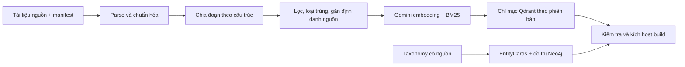
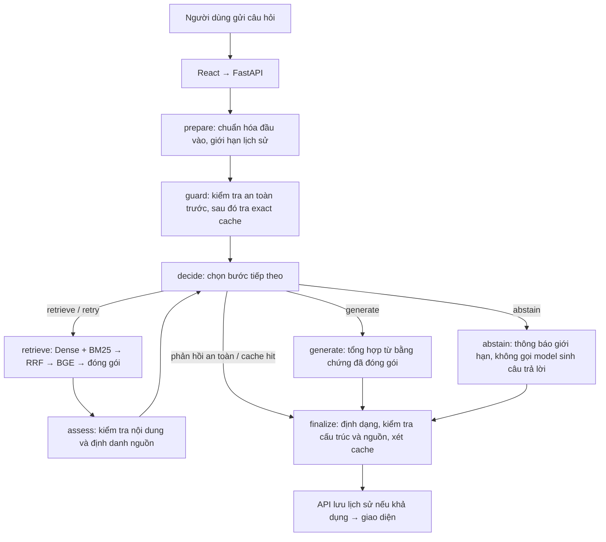

<!-- markdownlint-configure-file
{"MD013":{"tables":false,"code_blocks":false}}
-->

# Acne Advisor AI

**Trợ lý tra cứu thông tin về mụn và chăm sóc da liên quan bằng tiếng Việt, dựa
trên kho tài liệu có nguồn gốc rõ ràng.**

Người dùng đặt câu hỏi trên giao diện chat. Hệ thống tìm các đoạn tài liệu liên
quan, xem xét khả năng đáp ứng câu hỏi, rồi dùng mô hình ngôn ngữ tổng hợp câu
trả lời kèm nguồn. Nếu chưa tìm được bằng chứng phù hợp, Agent có thể tìm thêm
một lần hoặc thông báo giới hạn thông tin.

Dự án sử dụng **Agentic RAG có giới hạn**. RAG là cách truy xuất tài liệu trước
khi tạo câu trả lời; Agentic nghĩa là mô hình được chọn bước tiếp theo trong quy
trình. Python kiểm tra quyết định và giới hạn số lần tìm kiếm, thời gian xử lý,
nguồn trích dẫn và điều kiện lưu cache.

Đây là hệ thống hỗ trợ tìm hiểu thông tin, phục vụ nghiên cứu và phát triển cục
bộ. Hệ thống chưa được kiểm định lâm sàng; không thực hiện chẩn đoán, kê đơn cá
nhân hoặc phân tích ảnh da.

## Mục lục

- [1. Chức năng](#1-chức-năng)
- [2. Kiến trúc và luồng xử lý](#2-kiến-trúc-và-luồng-xử-lý)
- [3. Kho tri thức và dữ liệu](#3-kho-tri-thức-và-dữ-liệu)
- [4. Cài đặt và chạy bằng Docker](#4-cài-đặt-và-chạy-bằng-docker)
- [5. Phát triển trên Antigravity](#5-phát-triển-trên-antigravity)
- [6. Cấu hình](#6-cấu-hình)
- [7. API](#7-api)
- [8. Kiểm thử và notebook đánh giá](#8-kiểm-thử-và-notebook-đánh-giá)
- [9. Cấu trúc mã nguồn](#9-cấu-trúc-mã-nguồn)
- [10. Xử lý lỗi](#10-xử-lý-lỗi)
- [11. Giới hạn và tài liệu chi tiết](#11-giới-hạn-và-tài-liệu-chi-tiết)

## 1. Chức năng

- Hỏi về mụn, chăm sóc da liên quan, vai trò hoạt chất và những lưu ý được tài
  liệu hỗ trợ.
- Đặt câu hỏi tiếp nối; hệ thống dùng lịch sử hội thoại có giới hạn để hiểu câu
  hỏi hiện tại.
- Xem nguồn tài liệu được dùng và mô hình thực sự đã tạo câu trả lời.
- Chọn Gemini hoặc Ollama khi model khả dụng; tùy chọn fallback nằm trong phần
  nâng cao.
- Tạo, đổi tên, ẩn và xem lại cuộc trò chuyện. PostgreSQL lưu lịch sử phía máy
  chủ; trình duyệt giữ trạng thái cục bộ và đồng bộ theo ID tin nhắn.

Ví dụ để khám phá: “Mụn hình thành như thế nào?”, “Adapalene và benzoyl peroxide
khác nhau ở điểm nào?”, “Khi nào tình trạng mụn cần đi khám?”. Khả năng trả lời
phụ thuộc bằng chứng trong kho tri thức và trạng thái dịch vụ.

## 2. Kiến trúc và luồng xử lý

Hệ thống có hai quy trình riêng: **chuẩn bị kho tri thức** và **trả lời câu hỏi
trực tuyến**. Một lượt chat đọc chỉ mục đã kích hoạt; không tự crawl website,
xây lại dữ liệu hoặc ghi thêm kiến thức vào Qdrant.

### Các thành phần

| Thành phần           | Công nghệ                   | Vai trò                                              |
| -------------------- | --------------------------- | ---------------------------------------------------- |
| Giao diện            | React 19, Vite              | Chat, lịch sử, chọn model, hiển thị nguồn            |
| API                  | FastAPI                     | Kiểm tra đầu vào, gọi Agent, quản lý HTTP và lịch sử |
| Điều phối            | LangGraph                   | Thực thi các bước và vòng truy xuất hữu hạn          |
| Tạo văn bản          | Gemini / Ollama             | Chọn hành động và tổng hợp câu trả lời               |
| Truy xuất            | Qdrant + Gemini Embedding 2 | Tìm theo ngữ nghĩa và từ khóa BM25                   |
| Xếp hạng lại         | BGE cross-encoder cục bộ    | Sắp xếp ứng viên sau khi hợp nhất                    |
| Lịch sử              | PostgreSQL                  | Lưu phiên chat và tin nhắn                           |
| Cache                | Redis                       | Tái sử dụng câu trả lời đủ điều kiện                 |
| Tri thức có cấu trúc | Neo4j, EntityCards          | Kiểm tra và nghiên cứu cấu trúc tri thức             |

Neo4j và chỉ mục EntityCards không tham gia truy xuất bằng chứng cho câu trả lời
thông thường. Bằng chứng trực tuyến đến từ các knowledge chunk trong Qdrant.

### Luồng A — Chuẩn bị kho tri thức



Mỗi đoạn giữ định danh tài liệu, nguồn, vị trí và hash nội dung để truy vết. Bộ
chia đoạn giữ cấu trúc tiêu đề, danh sách, bảng; giới hạn 2.400 ký tự Unicode,
không chồng lặp. Parse và embedding được tái sử dụng khi nội dung và hợp đồng xử
lý không đổi.

Build mới tạo collection ứng viên theo phiên bản. Kích hoạt build là thao tác
bảo trì có kiểm tra và yêu cầu bản sao lưu phục hồi; không chạy tự động khi mở
ứng dụng.

### Luồng B — Từ câu hỏi đến câu trả lời



LangGraph có đúng **8 node**: `prepare`, `guard`, `decide`, `retrieve`,
`assess`, `generate`, `abstain`, `finalize`. `retry` là hành động quay lại node
`retrieve`.

Một lượt xử lý thông thường:

1. **Chuẩn bị:** giới hạn độ dài câu hỏi và lịch sử, giữ ngữ cảnh cần thiết cho
   câu hỏi hiện tại.
2. **An toàn và cache:** áp dụng các quy tắc an toàn hẹp đã định nghĩa; nếu
   không khớp mới tra cache. Phản hồi an toàn/cache hit bỏ qua các lời gọi model
   và truy xuất.
3. **Chọn hành động:** mô hình trả JSON đề xuất `retrieve`, `retry`, `generate`
   hoặc `abstain`. Python kiểm tra tính hợp lệ trước khi thực thi.
4. **Tìm bằng chứng:** Dense tìm theo ngữ nghĩa bằng vector Gemini; BM25 tìm
   theo từ khóa. Hai nhánh chạy song song trong Qdrant, sau đó hợp nhất thứ hạng
   bằng RRF.
5. **Xếp hạng và đóng gói:** BGE đọc cặp câu hỏi–đoạn văn để xếp lại ứng viên.
   Packer giữ nguyên đoạn, loại trùng và giữ thông tin nguồn trong giới hạn
   context.
6. **Quyết định lại:** `assess` chỉ xác nhận có văn bản và định danh nguồn; mô
   hình quyết định bằng chứng có đáp ứng câu hỏi hay cần tìm thêm/từ chối.
7. **Kết thúc:** nếu được phép, mô hình tổng hợp từ context đã đóng gói. Hệ
   thống xử lý trình bày, kiểm tra cấu trúc/nguồn, xét cache và trả kết quả.

### Các giới hạn mặc định

| Tham số                    |                     Giá trị | Ý nghĩa                               |
| -------------------------- | --------------------------: | ------------------------------------- |
| Thực thi truy xuất         |                Tối đa 2 lần | Lần đầu và tối đa một lần tìm bổ sung |
| Ứng viên mỗi kênh          |                          16 | Giới hạn đầu vào cho hợp nhất         |
| Context đưa vào model      | Tối đa 9 đoạn / 7.000 ký tự | Giữ nguyên đoạn cùng thông tin nguồn  |
| RRF                        |  `k=60`, hai trọng số `1.0` | Hợp nhất theo thứ hạng                |
| Timeout mỗi kênh truy xuất |                     20 giây | Hai kênh có timeout riêng             |
| Tổng ngân sách Agent       |                    210 giây | Các bước dùng chung deadline          |

Khi tìm bổ sung, hệ thống hợp ứng viên cũ và mới, loại trùng rồi xếp hạng lại
toàn bộ. Nếu một kênh tìm kiếm lỗi, bằng chứng từ kênh còn lại được giữ. Lỗi BGE
giữ thứ tự dự phòng có tính xác định. Các giới hạn và điểm số này là chính sách
kỹ thuật, không phải độ tin cậy y khoa.

Redis dùng **exact cache**, so khớp câu hỏi sau chuẩn hóa cùng provider, model,
phiên bản và fingerprint pipeline. Câu trả lời phụ thuộc lịch sử, phản hồi an
toàn, fallback hoặc không đạt điều kiện kiểm tra không được lưu như câu trả lời
thông thường. Fallback model cần cả cấu hình máy chủ và sự cho phép trong
request.

## 3. Kho tri thức và dữ liệu

Build đã kích hoạt được ghi trong
[`data/knowledge_build_manifest.json`](data/knowledge_build_manifest.json):
**`d4a1819fe7fb77fe1f40`**.

| Tài sản          | Quy mô / cấu hình                                 |
| ---------------- | ------------------------------------------------- |
| Bộ nguồn         | 4 snapshot/nhóm nguồn được quản lý trong manifest |
| Knowledge chunks | 536 đoạn                                          |
| EntityCards      | 32 thẻ                                            |
| Neo4j            | 32 node, 27 quan hệ                               |
| Dense vectors    | `models/gemini-embedding-2`, 3.072 chiều, cosine  |
| Sparse vectors   | BM25 gốc của Qdrant                               |
| Alias logic      | `acne_knowledge`, `acne_entities`                 |

Nguồn gồm snapshot NICE NG198, hướng dẫn AAD/JAAD, trích đoạn hướng dẫn da liễu
Bộ Y tế Việt Nam và tập trang giáo dục cộng đồng từ nhiều nhà xuất bản. Danh
tính, hash và giới hạn nguồn nằm trong
[manifest nguồn](data/sources/manifest.yaml). “4 nguồn” không có nghĩa chỉ có 4
trang web.

**Git lưu mã nguồn, manifest và các kết quả nghiên cứu được chọn.** File nguồn
trong `sample_data/`, dữ liệu database trong `data/`, API key, môi trường
Python, `node_modules` và model weights không đi kèm bản clone. Máy mới cần được
cấp kho dữ liệu hợp lệ hoặc chuẩn bị tri thức theo
[quy trình dữ liệu](docs/DATA_PIPELINE.md) và
[vận hành](docs/OPERATIONS.md#knowledge-build) trước khi chat RAG hoạt động.

Với môi trường đã có dữ liệu, kiểm tra bằng:

```powershell
.\.venv\Scripts\python.exe scripts\knowledge_build.py status
.\.venv\Scripts\python.exe scripts\knowledge_build.py validate
```

Không dùng rebuild/re-embed như cách sửa lỗi kết nối hoặc lỗi IDE. Ứng dụng
thông thường tái sử dụng build đang hoạt động.

## 4. Cài đặt và chạy bằng Docker

Các lệnh dưới đây dành cho **Windows PowerShell**, chạy từ thư mục gốc trừ khi
có chỉ dẫn khác.

### Chuẩn bị chung

```powershell
git clone https://github.com/MinhHoang1403/Acne_Advisor_AI.git
Set-Location Acne_Advisor_AI
if (-not (Test-Path .env)) { Copy-Item .env.example .env }
```

Điền `GOOGLE_API_KEY` thật trong `.env` để dùng Gemini và Dense embedding. Giữ
nguyên embedding model/dimension nếu dùng chỉ mục hiện có. Chuẩn bị Docker
Desktop với Linux containers/WSL 2, kho Qdrant đã kích hoạt và cache model
`BAAI/bge-reranker-v2-m3`.

Nếu chưa có model, dùng môi trường Python ở
[phần phát triển](#5-phát-triển-trên-antigravity) để tải một lần:

```powershell
.\.venv\Scripts\python.exe -c "from huggingface_hub import snapshot_download; snapshot_download('BAAI/bge-reranker-v2-m3')"
```

Model tương đối lớn. Backend đọc model cục bộ khi khởi động, không tự tải model
hoặc khởi tạo chỉ mục. Compose mặc định gắn cache từ
`${USERPROFILE}/.cache/huggingface/hub`; đặt `HF_MODEL_CACHE_PATH` trong `.env`
nếu dùng thư mục khác.

### Khởi động toàn bộ ứng dụng

Khi dữ liệu và cache đã sẵn sàng, cách này không cần Python/Node trên máy host
để chạy ứng dụng:

```powershell
docker compose config --quiet
docker compose build backend frontend
docker compose up -d
docker compose ps
```

Máy NVIDIA đã hỗ trợ GPU trong Docker dùng lệnh sau **thay cho** lệnh `up` ở
trên:

```powershell
docker compose -f docker-compose.yml -f docker-compose.gpu.yml up -d
```

| Địa chỉ                            | Mục đích                    |
| ---------------------------------- | --------------------------- |
| <http://127.0.0.1:8088>            | Giao diện chat              |
| <http://127.0.0.1:8000/docs>       | Swagger / OpenAPI           |
| <http://127.0.0.1:8088/api/live>   | API đang chạy               |
| <http://127.0.0.1:8088/api/ready>  | Phụ thuộc cốt lõi sẵn sàng  |
| <http://127.0.0.1:8088/api/health> | Chi tiết trạng thái dịch vụ |

Nginx phục vụ frontend và chuyển `/api/...` tới backend. Backend dùng một worker
và một model BGE trong process. Mặc định yêu cầu CUDA/BF16; khi phần cứng không
hỗ trợ, reranker báo cấu hình thực tế và dùng CPU/FP32 phù hợp.

```powershell
docker compose logs --tail 80 backend frontend
docker compose stop
```

Dữ liệu PostgreSQL, Redis, Qdrant và Neo4j nằm ở các bind mount dưới `data/`.
`stop` giữ dữ liệu; tránh xóa thư mục dữ liệu hoặc dọn Docker toàn cục để xử lý
lỗi khởi động.

## 5. Phát triển trên Antigravity

### Tạo môi trường phát triển

Cần **Python 3.11** (`3.11.9` dùng trong CI), **Node.js 24**, npm và Docker
Desktop. Từ thư mục gốc:

```powershell
py -3.11 -m venv .venv
.\.venv\Scripts\python.exe -m pip install --upgrade pip==26.1.2
.\.venv\Scripts\python.exe -m pip install -r requirements.lock.txt
Push-Location src\frontend
npm.cmd ci
Pop-Location
```

Luôn dùng interpreter của `.venv` để tránh chạy nhầm Python toàn cục. Không cần
kích hoạt venv nếu gọi đường dẫn đầy đủ. Kiểm tra GPU trước khi kỳ vọng CUDA
hoạt động:

```powershell
nvidia-smi
.\.venv\Scripts\python.exe -c "import torch; print(torch.__version__, torch.version.cuda, torch.cuda.is_available())"
.\.venv\Scripts\python.exe -m pip check
```

Nếu CUDA chưa khả dụng, kiểm tra driver và bản PyTorch phù hợp; có thể đặt
`RERANKER_DEVICE=cpu` cho môi trường CPU. Dự án không yêu cầu cài CUDA
Toolkit/cuDNN riêng để dùng các thư viện runtime do wheel PyTorch cung cấp.

### Mở đúng workspace

Trong Antigravity chọn **File → Open Workspace from File…** và mở
[`acne-advisor.code-workspace`](acne-advisor.code-workspace).

Workspace đặt interpreter `.venv\Scripts\python.exe`, terminal PowerShell riêng
và UTF-8 cho dự án. Cấu hình không chứa đường dẫn tài khoản cá nhân hoặc API
key. Các extension đề xuất gồm Python, Python Debugger, Jupyter và Ruff.

Mở một file `.py` và kiểm tra thanh trạng thái: Python phải là **3.11.x
(`.venv`)**. Nếu IDE còn nhớ interpreter cũ, dùng **Python: Select Interpreter**
để chọn lại `.venv\Scripts\python.exe`. Mở terminal mới sau khi đổi
workspace/interpreter.

### Chạy mã nguồn trên host

Nếu Docker đang chạy cả frontend/backend, dừng hai lớp ứng dụng để dùng cổng mặc
định cho chế độ phát triển:

```powershell
docker compose stop backend frontend
docker compose pull postgres redis qdrant neo4j
.\scripts\start_local_dev.ps1
```

Launcher khởi động bốn datastore, FastAPI tại **8000** và Vite tại **5173**. Nó
kiểm tra Python, dependency frontend và lỗi Docker; log nằm ở `logs/local-dev/`.
API reload chỉ trong `src/`. Vite nhận địa chỉ backend từ launcher, kể cả khi
đổi cổng:

```powershell
.\scripts\start_local_dev.ps1 -DryRun
.\scripts\start_local_dev.ps1 -ApiPort 8001
```

Dùng cổng **8001** cho phép kiểm tra backend mã nguồn song song với backend
Docker đang dùng **8000**. Launcher tái sử dụng dịch vụ phù hợp, báo lỗi nếu
cổng bị chiếm không tương thích và không tự chuyển Vite sang cổng khác. Khi đổi
cổng frontend, bổ sung origin vào `CORS_ALLOW_ORIGINS`.

Nếu muốn tự quản lý process trong hai terminal, dùng:

```powershell
# Terminal 1, tại thư mục gốc
.\.venv\Scripts\python.exe -m uvicorn src.api.app:app --reload --reload-dir src --host 127.0.0.1 --port 8000
```

```powershell
# Terminal 2
Set-Location src\frontend
npm.cmd run dev -- --host 127.0.0.1 --port 5173 --strictPort
```

Frontend host mặc định gọi `http://127.0.0.1:8000`. Nếu chạy thủ công với API
khác cổng, đặt `$env:VITE_API_URL` trước khi mở Vite. Các lệnh thủ công dừng
bằng `Ctrl+C` trong terminal tương ứng.

Chỉ với PostgreSQL mới, chưa có schema, khởi tạo bằng `scripts/init_schema.py`
và `scripts/init_chat_schema.py`. Các script này không tạo kho bằng chứng
Qdrant. Lần đầu nạp model có thể cần vài phút; launcher chờ tối đa 240 giây và
lưu lỗi vào log.

## 6. Cấu hình

[`.env.example`](.env.example) là mẫu đầy đủ. `.env` thật chỉ lưu trên máy chạy.
Mọi biến `VITE_*` có thể xuất hiện trong trình duyệt nên không dùng để chứa bí
mật.

| Nhóm       | Biến chính                                                 | Ghi chú                                                                               |
| ---------- | ---------------------------------------------------------- | ------------------------------------------------------------------------------------- |
| Gemini     | `GOOGLE_API_KEY`, `GOOGLE_MODEL`, `GOOGLE_FALLBACK_MODELS` | Mặc định `gemini-3.5-flash-lite`; fallback Gemini cấu hình là `gemini-3.1-flash-lite` |
| Embedding  | `EMBEDDING_MODEL`, `EMBEDDING_DIMENSIONS`                  | Phải khớp chỉ mục: Gemini Embedding 2 / 3072                                          |
| Ollama     | `OLLAMA_BASE_URL`, `OLLAMA_MODEL`                          | Mặc định `qwen3:8b`; cần cài Ollama và có model nếu sử dụng                           |
| Reranker   | `RERANKER_MODEL`, `RERANKER_DEVICE`, `RERANKER_PRECISION`  | BGE cục bộ; mặc định `cuda` / `bfloat16`                                              |
| Database   | `DATABASE_URL`, `REDIS_URL`, `QDRANT_URL`, `NEO4J_URI`     | Host/container dùng địa chỉ khác nhau; Compose đặt địa chỉ nội bộ                     |
| Frontend   | `VITE_API_URL`, `CORS_ALLOW_ORIGINS`                       | Host mặc định API 8000; Docker dùng `/api` cùng origin                                |
| Theo dõi   | `OBSERVABILITY_ENABLED`, `LANGFUSE_ENABLED`                | Tùy chọn, mặc định tắt; JSONL/Langfuse phục vụ chẩn đoán                              |
| Nghiên cứu | `LLAMA_CLOUD_API_KEY`, `OPENAI_API_KEY`                    | Parse PDF/đánh giá tương ứng; không bắt buộc cho chat đã có chỉ mục                   |

Chọn Ollama chỉ thay đường tạo văn bản; Dense embedding hiện vẫn dùng API Google
nên toàn bộ pipeline chưa offline. Health kiểm tra cấu hình/key hiện diện và
model Ollama có trong danh sách; không chứng minh một lần sinh câu trả lời thực
tế đã thành công.

## 7. API

Entrypoint: `src.api.app:app`. Đường dẫn dưới đây là đường trực tiếp của
FastAPI; qua frontend Docker, thêm tiền tố `/api`.

| Method   | Đường dẫn                                                                | Chức năng                                                    |
| -------- | ------------------------------------------------------------------------ | ------------------------------------------------------------ |
| `GET`    | `/live`, `/ready`, `/health`                                             | Sống, sẵn sàng cốt lõi, trạng thái chi tiết                  |
| `GET`    | `/models`                                                                | Danh sách model và khả dụng                                  |
| `POST`   | `/chat`                                                                  | Gửi câu hỏi và lịch sử có giới hạn                           |
| `GET`    | `/chat/sessions`                                                         | Liệt kê phiên chat                                           |
| `GET`    | `/chat/sessions/{session_id}/messages`                                   | Đọc tin nhắn                                                 |
| `PATCH`  | `/chat/sessions/{session_id}/rename`, `/chat/sessions/{session_id}/hide` | Đổi tên hoặc ẩn phiên                                        |
| `POST`   | `/chat/sessions/sync`                                                    | Đồng bộ lịch sử tương thích                                  |
| `DELETE` | `/chat/sessions`                                                         | Xóa lịch sử chat và key answer-cache của ứng dụng            |
| `GET`    | `/retrieve?q=...`                                                        | Chẩn đoán truy xuất; mặc định tắt, dành cho operator tin cậy |

Body tối thiểu của `POST /chat`:

```json
{
  "message": "Mụn hình thành như thế nào?",
  "conversation_history": [],
  "allow_model_fallback": false
}
```

Response gồm `answer`, `session_id`, `sources`, `source_metadata`, `metadata`.
Có thể gửi UUID `request_id` nhận diện lượt; gửi lại cùng ID/nội dung giúp tránh
tạo trùng khi persistence hoạt động. Đây là cơ chế best effort trong một
process, không phải bảo đảm thực thi đúng một lần trên hệ phân tán.

## 8. Kiểm thử và notebook đánh giá

### Kiểm tra phần mềm

```powershell
.\.venv\Scripts\python.exe -m pip check
.\.venv\Scripts\python.exe -m ruff check src scripts tests
.\.venv\Scripts\python.exe -m pytest -q
.\.venv\Scripts\python.exe scripts\check_reproducible_environment.py
.\.venv\Scripts\python.exe scripts\check_release_readiness.py --mode offline
.\.venv\Scripts\python.exe scripts\inspect_runtime_readiness.py
```

`--mode offline` kiểm tra hợp đồng không gọi model thật;
`inspect_runtime_readiness.py` đọc manifest và datastore đang chạy. `/ready` trả
503 nếu phụ thuộc cốt lõi chưa sẵn sàng.

```powershell
Push-Location src\frontend
npm.cmd test
npm.cmd run lint
npm.cmd run build
Pop-Location
```

GitHub Actions chạy Python trên Windows/Python 3.11.9 và frontend trên Node 24.
Test xác nhận hợp đồng phần mềm, không thay thế đánh giá ngữ nghĩa hoặc kiểm
định y khoa.

### Môi trường notebook riêng

Ứng dụng khóa `sentence-transformers==5.6.0` / `transformers==5.15.1`;
RAGChecker 0.1.9 cần Transformers 4 qua `refchecker`. Dùng **`evaluation/.venv`
riêng**, theo [hướng dẫn notebook](evaluation/README.md).

Chọn kernel **Acne Advisor AI (evaluation)** cho
[notebook kiểm tra môi trường](evaluation/environment_check.ipynb). Notebook
kiểm tra thư viện, spaCy và việc đọc benchmark/kết quả đã lưu, không gọi API
đánh giá. Kernel **Acne Advisor AI (runtime)** dùng `.venv` ở gốc cho
Agent/reranker. Không cài gộp hai bộ dependency.

### Phân biệt kết quả lịch sử và build hiện tại

| Bộ kết quả                                                                   | Hệ thống / KB                                | Trạng thái                                                                  |
| ---------------------------------------------------------------------------- | -------------------------------------------- | --------------------------------------------------------------------------- |
| [formal_run_2d5f0124](evaluation/results/formal_run_2d5f0124/)               | Commit `2d5f0124`, KB `94d613bc9b33628de3ef` | Hoàn tất 100 ca, không có lỗi hạ tầng                                       |
| [thesis_evaluation_366f3ad8](evaluation/results/thesis_evaluation_366f3ad8/) | Commit `366f3ad8`, KB `d4a1819fe7fb77fe1f40` | 100 output đã khóa; chấm RAGChecker chưa hoàn tất vì hết tín dụng evaluator |

Kết quả lịch sử: Claim Recall **72,3%**, Context Precision **38,9%**,
Faithfulness **87,7%**, Claim F1 **33,8%** trên 70 ca answerable; Negative
Rejection Rate **80,0% (24/30)**. Không gán các số này cho mã nguồn/build mới
hơn.

Gold của build hiện tại tách **24 ca xác nhận thiếu bằng chứng** và **6 ca mơ hồ
chính sách**. Notebook nghiên cứu cũ kiểm tra commit, fingerprint, KB lịch sử;
khôi phục môi trường không bỏ qua các điều kiện đó. Đọc
[kết quả](evaluation/results/README.md),
[giao thức luận văn](evaluation/THESIS_EVALUATION_PROTOCOL.md) và
[chỉ mục nghiên cứu](research/README.md) trước khi tiếp tục chấm API.

## 9. Cấu trúc mã nguồn

```text
acne-agent-system/
├── src/
│   ├── frontend/       # React/Vite, HTTP client, hội thoại
│   ├── api/            # FastAPI, request/response, health
│   ├── agent/          # LangGraph, quyết định, prompt, an toàn, trình bày
│   ├── retrieval/      # Dense/BM25, RRF, BGE, đóng gói context
│   ├── ingestion/      # Parse, chia đoạn, provenance, indexing, activation
│   ├── knowledge/      # Taxonomy, EntityCards, đồ thị, phiên bản KB
│   ├── integrations/   # Adapter SDK dịch vụ bên ngoài
│   ├── database/       # Qdrant adapter, SQL, lịch sử
│   ├── cache/          # Exact cache Redis
│   ├── quality/        # Kiểm tra cấu trúc, nguồn, safe fallback
│   ├── resilience/     # Deadline, timeout, retry hữu hạn
│   └── observability/  # Trace, fingerprint, Langfuse tùy chọn
├── scripts/            # Lệnh vận hành và kiểm tra
├── tests/              # Kiểm thử và fixture
├── data/               # Manifest được quản lý; dữ liệu runtime bỏ qua Git
├── evaluation/         # Benchmark, kernel riêng, kết quả đánh giá
├── research/           # Experiment đã lưu, không phải backend khác
├── docs/               # Tài liệu chi tiết
├── docker/             # Dockerfile backend
├── acne-advisor.code-workspace
├── docker-compose.yml
└── .env.example
```

Đọc code theo một lượt chat: `src/frontend/src/App.jsx` →
`src/frontend/src/api/chatApi.js` → `src/api/app.py` → `src/agent/graph.py` →
`src/agent/nodes/workflow.py`. Tiếp theo đọc `src/retrieval/service.py` cho truy
xuất và `src/agent/nodes/reason.py` cho tạo câu trả lời.

## 10. Xử lý lỗi

| Hiện tượng                                         | Kiểm tra / xử lý                                                                                                        |
| -------------------------------------------------- | ----------------------------------------------------------------------------------------------------------------------- |
| Antigravity chọn Python 3.12 hoặc đường dẫn đã mất | Mở workspace dự án, chọn lại `.venv\Scripts\python.exe`; dự án cần 3.11                                                 |
| `.venv` hỏng sau khi xóa AppData                   | Kiểm tra `.venv/pyvenv.cfg`; dùng Python 3.11 còn hoạt động để tạo lại môi trường và cài lock, giữ riêng `.env`/dữ liệu |
| Thiếu `pip`                                        | Chạy `.\.venv\Scripts\python.exe -m ensurepip --upgrade`, sau đó cài pip theo hướng dẫn                                 |
| PowerShell chặn `npm.ps1`                          | Dùng `npm.cmd`                                                                                                          |
| Docker chưa chạy hoặc thiếu image                  | Mở Docker Desktop, kiểm tra `docker version`, pull bốn image datastore rồi chạy lại                                     |
| Thiếu cache BGE                                    | Kiểm tra cache/HF_MODEL_CACHE_PATH, tải model một lần trước khi chạy                                                    |
| UI gọi nhầm API                                    | Kiểm tra cổng, `VITE_API_URL`, CORS; dùng launcher để truyền địa chỉ chính xác                                          |
| 502 lúc API đang tải model                         | Theo dõi log backend, chờ `/live`, sau đó kiểm tra `/ready`                                                             |
| `/ready` trả 503                                   | Đọc `/health`, kiểm tra Qdrant/alias/schema và cấu hình provider trước khi sửa dữ liệu                                  |
| Chat lỗi provider dù health báo cấu hình hợp lệ    | Kiểm tra API key, kết nối, hạn mức; health không sinh câu trả lời                                                       |
| Notebook xung đột Transformers                     | Chọn kernel evaluation, cài lock của evaluation vào môi trường riêng                                                    |

## 11. Giới hạn và tài liệu chi tiết

Kho nguồn còn nhỏ, không bao phủ toàn bộ da liễu. Snapshot NICE có ngày biểu
diễn `2026-08-03`, khác metadata chính thức `2026-04-30` được ghi nhận trong
manifest; tính đầy đủ/tương đương phiên bản chính thức còn cần đối chiếu. Không
âm thầm thay nhãn nguồn hoặc dùng kết quả nghiên cứu như kiểm định lâm sàng.

Kiểm tra nguồn/cấu trúc xác nhận danh tính nguồn, hình dạng câu trả lời và
provenance; không chứng minh từng mệnh đề được hỗ trợ hoặc đúng lâm sàng. Các
quy tắc an toàn bao phủ một tập tình huống hẹp, không phải bộ phân loại y khoa
tổng quát.

Phạm vi triển khai là **cục bộ, một người dùng tin cậy**. Compose chỉ publish
trên `127.0.0.1`; API lịch sử chưa có xác thực/ủy quyền đa người dùng. Triển
khai công khai cần bổ sung xác thực, TLS, giới hạn truy cập, cách ly dữ liệu và
vận hành phù hợp.

| Tài liệu                                                                                       | Nội dung                               |
| ---------------------------------------------------------------------------------------------- | -------------------------------------- |
| [Kiến trúc](docs/ARCHITECTURE.md), [workflow Agent](docs/AGENT_WORKFLOW.md)                    | Trách nhiệm và ranh giới thành phần    |
| [Hướng dẫn đọc code tiếng Việt](docs/CODE_GUIDE_VI.md)                                         | Chi tiết module và đường đi dữ liệu    |
| [Pipeline dữ liệu](docs/DATA_PIPELINE.md), [vận hành](docs/OPERATIONS.md)                      | Build, kiểm tra, activation, chẩn đoán |
| [Phương pháp/công thức](docs/METHODS_AND_FORMULAS.md), [truy vết](docs/METHOD_TRACEABILITY.md) | Hợp đồng kỹ thuật và cơ sở lựa chọn    |
| [An toàn](docs/SAFETY.md)                                                                      | Quy tắc hẹp và nguồn liên quan         |
| [Observability](docs/OBSERVABILITY.md)                                                         | Trace và Langfuse                      |
| [Tham chiếu](docs/REFERENCES.md), [registry](data/method_sources.json)                         | Nguồn kỹ thuật và tri thức             |

Metadata trong `pyproject.toml` khai báo MIT; repository hiện chưa có `LICENSE`
riêng. Quyền sử dụng tài liệu nguồn thuộc từng nhà xuất bản và cần được xem xét
riêng khi phân phối corpus.
